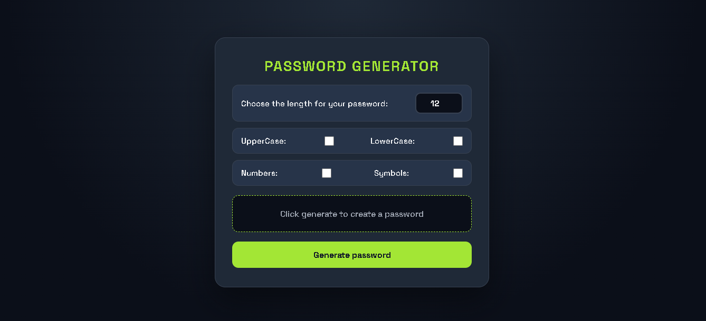
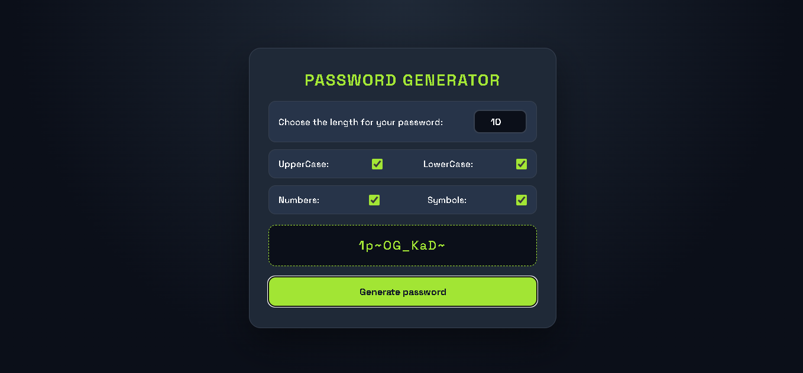

# Password Generator

A simple tool that creates random, secure passwords. Choose a length from 1 to 50, pick which character types to include (uppercase, lowercase, numbers, symbols), and generate a password. Click the password to copy it to your clipboard.

## Screenshots

### Password options


### Generated password


## Features

- Password length from 1 to 50 characters
- Choose uppercase, lowercase, numbers, and symbols, in any combination
- Uses the browser's `crypto.getRandomValues()` for stronger randomness than `Math.random()`
- Click the generated password to copy it
- Popups for invalid length, no character type selected, and successful copy
- Responsive layout for phones and desktops

## How to Run

1. Clone the repository:
   ```bash
   git clone https://github.com/abdallaahemd/Password-Generator.git
   ```
2. Open the project folder.
3. Open `index.html` in your browser.

For the copy feature to work, open the page from `localhost` or a secure (`https`) site. Some browsers block clipboard access when a file is opened directly from disk.

## Project Structure

```
Password-Generator/
├── index.html      # Page layout and options
├── style.css       # Styles
├── script.js       # Password logic, copy feature, and popup
└── screenshots/    # Screenshots used in this README
```

## What I Learned

- Building arrays of characters with `split()` and combining them with `concat()`
- Generating random values with `Math.random()` and `crypto.getRandomValues()`
- Reading checkbox and number input values
- Using the Clipboard API with `async` / `await`
- Validating user input before using it

## Built With

- HTML
- CSS
- JavaScript

## Author

**Abdallah Ahmed**: Programming instructor and developer
- LinkedIn: https://www.linkedin.com/in/abdalla-konsowa-386414203
- itch.io: https://abdallak.itch.io/
